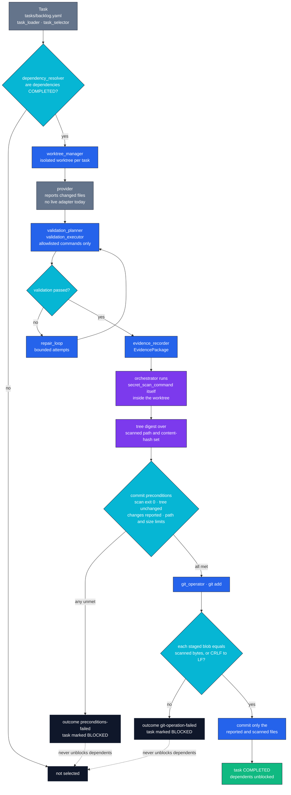
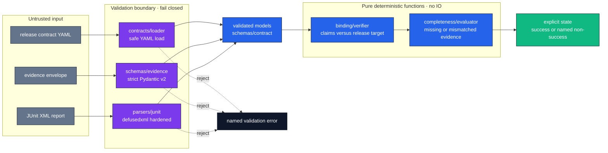

<div align="center">

# 🔧 QualityMesh

### Fail-closed release evidence validation and commit integrity

**A release gate that refuses to say "done" when it cannot prove it. Evidence that is missing,
mismatched or unscanned stays in an explicit non-success state — it can never silently satisfy a
requirement. The automation harness runs its own secret scanner and verifies the exact bytes Git
is about to commit against the bytes that were scanned.**

[](https://github.com/ckvishwa/QualityMesh/actions/workflows/validate.yml)
[](https://github.com/ckvishwa/QualityMesh/actions/workflows/validate.yml)
[](https://github.com/ckvishwa/QualityMesh/actions/workflows/validate.yml)
[](pyproject.toml)

[](src/qualitymesh/schemas/)
[](pyproject.toml)
[](pyproject.toml)
[](pyproject.toml)
[](uv.lock)

[Overview](#-overview) · [Problem](#-problem-statement) · [Features](#-capability-matrix) · [Architecture](#-system-architecture) · [How it works](#-how-it-works) · [Security fixes](#-security-fixes-proven-by-regression-tests) · [Testing](#-testing--quality-assurance) · [Quick start](#-quick-start) · [Decisions](#-engineering-decisions) · [Limits](#-known-limitations)

</div>

---

## 📌 Overview

| | |
|---|---|
| **What it does** | Two cooperating halves. The **release-evidence engine** (`src/qualitymesh/`) loads a versioned release contract, validates an evidence envelope, parses JUnit XML, verifies that evidence claims bind to the release target, and evaluates completeness. The **automation harness** (`automation/`) drives a task through validation, evidence recording, a secret scan and Git commit — and blocks the task rather than completing it whenever a precondition is unmet. |
| **The problem it solves** | Release gates fail open. A missing report, a claim that does not match the artifact, a secret scan that never ran, a clean filter that rewrites a file between scan and commit — each of these normally produces a green tick. Here each one produces a non-success state with a name. |
| **Who benefits** | Anyone who has to defend a release decision afterwards. Every outcome is a named state with recorded evidence, not a boolean. |
| **Why the architecture** | Binding verification and completeness evaluation are **pure functions** over validated models. They cannot reach the filesystem, the network or a clock, so a given evidence set always produces the same verdict — which is the only way an audit trail means anything. |

> Integrity proves that the approved bytes did not change. It does not prove that the approved bytes
> were safe in the first place.

---

## 🎯 Problem Statement

The concrete failure this project is built around: **a release pipeline that reports success for
work it never verified.** Four real instances were found in this codebase's own automation harness
and fixed, each with a regression test that reproduces the original behaviour first:

1. A caller could pass `secret_scan_clean=True` and the harness would commit with **no scanner run
   at all**.
2. A Git clean filter could rewrite a file during `git add`, so the scanner approved one set of
   bytes and a **different blob** was committed.
3. With Git writes disabled or `auto_commit` off, the cycle skipped every precondition and scope
   check and reported `COMPLETED` — and because `COMPLETED` unblocks dependent tasks, that
   propagated.
4. The first fix for (2) was too strict and rejected ordinary CRLF-to-LF normalisation, failing on
   Windows where `core.autocrlf` is on — a fail-closed bug is still a bug.

A gate that is wrong in the permissive direction is worse than no gate, because it is trusted.

---

## ✨ Capability Matrix

### Release-evidence engine — `src/qualitymesh/`

| Capability | Verified behaviour | Status |
|---|---|---|
| Versioned release-contract schema | Strict Pydantic v2 models; unknown fields and wrong types rejected | **Implemented** |
| Safe contract loading | YAML loaded without arbitrary object construction; malformed documents rejected with a named error | **Implemented** |
| Evidence-envelope schema | Strict validation of the envelope wrapping each evidence item | **Implemented** |
| Hardened JUnit XML parsing | `defusedxml`; hostile documents (entity expansion, external entities, malformed trees) are rejected, not parsed | **Implemented** |
| Evidence-to-contract binding verification | Deterministic comparison of evidence claims against a supplied release target | **Implemented** (pure function) |
| Evidence completeness evaluation | Deterministic: missing or mismatched evidence yields an explicit non-success state | **Implemented** (pure function, 100% coverage) |
| Policy evaluator with `BLOCK > INSUFFICIENT_EVIDENCE > WARN > PASS` | — | **Planned — does not exist** |
| Evidence ingestion (FR-3) | — | **Planned — does not exist** |
| Evidence kinds other than JUnit | — | **Planned — does not exist** |
| Producer identity / cryptographic provenance | — | **Not implemented** |
| Persistence, worker, API, GitHub integration | — | **Planned — does not exist** |

### Automation harness — `automation/`

| Capability | Verified behaviour | Status |
|---|---|---|
| Task loading and selection with dependency resolution | `COMPLETED` is what unblocks dependents, so completion is gated (see below) | **Implemented** |
| Isolated worktree per task | `worktree_manager.py` | **Implemented** |
| Allowlisted command execution | `command_policy` gates executable plus arguments; policy rejection blocks the cycle | **Implemented** |
| Validation planning and execution | `validation_planner.py`, `validation_executor.py` | **Implemented** |
| Evidence package recording | Command, exit status, scanned-tree digest in `EvidencePackage` | **Implemented** |
| **Caller-independent scanner execution** | The orchestrator runs `secret_scan_command` itself in the worktree; no caller attestation can substitute | **Implemented + regression-tested** |
| **Content identity check** | Scanned `(path, content-hash)` digest re-verified immediately before staging | **Implemented + regression-tested** |
| **Git staged-content verification** | After `git add`, every staged blob must equal the scanned worktree bytes, or those bytes with CRLF normalised to LF | **Implemented + regression-tested** |
| **Completion gate on non-commit cycles** | Dry runs and `auto_commit`-off tasks still enforce scope and precondition checks | **Implemented + regression-tested** |
| Safe failure / blocked-task behaviour | Unmet preconditions end `preconditions-failed` or `git-operation-failed` and mark the task `BLOCKED` | **Implemented** |
| Repair loop | `repair_loop.py` with bounded attempts | **Implemented** |
| Live coding-provider adapter | The harness has no live provider | **Not implemented** |
| Secret scanner of its own | Deliberately not shipped — the trusted workflow supplies the command | **Out of scope by design** |

---

## 🧱 System Architecture



### Release-evidence engine and its trust boundary



Nothing downstream of the validation boundary ever sees raw input. The planned policy evaluator will
consume these verdicts with the precedence `BLOCK > INSUFFICIENT_EVIDENCE > WARN > PASS` —
**that evaluator does not exist yet.**

---

## 🔄 How It Works

The commit path, step by step. Each numbered step is a place the cycle can stop.

| # | Step | Input | Check | On failure |
|---|---|---|---|---|
| 1 | **Select task** | `tasks/backlog.yaml` | Dependencies must be `COMPLETED` | Task not selected |
| 2 | **Isolate** | selected task | A dedicated Git worktree is created | Cycle aborts |
| 3 | **Provider work** | task context | Provider reports which files it changed | — *(no live adapter today)* |
| 4 | **Validate** | worktree | Planned commands run, each allowlisted in `command_policy` | `repair_loop`, bounded; then failure |
| 5 | **Record evidence** | validation results | `EvidencePackage` built | Cycle aborts |
| 6 | **Scan** | worktree | **The orchestrator executes `secret_scan_command` itself.** Exit status 0 required | Missing command, policy rejection, launch failure, timeout or non-zero exit all block the commit |
| 7 | **Digest** | scanned files | A digest over the scanned `(path, content-hash)` set is recorded | — |
| 8 | **Preconditions** | digest + reported changes | Tree unchanged during the scan; worktree changes match the provider's reported files; path and size limits respected | `preconditions-failed`, task `BLOCKED` |
| 9 | **Stage** | reported files | `git add` | `git-operation-failed` |
| 10 | **Verify staged bytes** | Git index | Every staged blob must equal the raw scanned worktree bytes, **or** those bytes with CRLF normalised to LF | `git-operation-failed`, task `BLOCKED` |
| 11 | **Commit** | index | Only the reported, scanned files are committed | — |
| 12 | **Complete** | outcome | `COMPLETED` is recorded and dependents are unblocked | — |

**Step 8 applies to every cycle, not only to one that commits.** With `allow_git_writes=False` or
`auto_commit` off, nothing leaves the worktree — but `COMPLETED` still unblocks dependent tasks, so
scope and precondition checks still run. Only the secret-scan requirement is waived, because nothing
is being committed.

---

## 🔒 Security Fixes Proven by Regression Tests

All four landed in [PR #1](https://github.com/ckvishwa/QualityMesh/pull/1) and are on `main`. Each
regression test fails against the pre-fix code.

| # | Weakness | Observed before the fix | Fix | Regression test |
|---|---|---|---|---|
| 1 | **Caller-attested secret scan** | `OrchestratorInputs.secret_scan_clean=True` let a commit through with **no scanner run**; a planted marker was committed with outcome `completed` | The field was removed outright — passing it is now a validation error. The orchestrator runs `secret_scan_command` in the worktree and derives the verdict from that run | [`test_orchestrator_completion_gate.py`](tests/automation/test_orchestrator_completion_gate.py) |
| 2 | **Scan/commit content divergence** | A Git clean filter rewrote a file at `git add`, so the scanner approved one set of bytes and a different blob was committed — reproduced with a planted marker in the committed blob | `run_git_operations` compares every staged blob with the worktree bytes and refuses to commit unless they are identical | [`test_orchestrator_staging.py`](tests/automation/test_orchestrator_staging.py) |
| 3 | **Over-strict staging check** | The first version of fix 2 also rejected legitimate CRLF-to-LF normalisation, failing hosted CI on Windows where `core.autocrlf` is on | CRLF-to-LF normalisation is accepted; any other rewrite is rejected | [`test_orchestrator_staging.py`](tests/automation/test_orchestrator_staging.py) |
| 4 | **Completion gate bypassed on non-commit cycles** | With `allow_git_writes=False` or `auto_commit` off, the cycle skipped every precondition and scope check and reported `COMPLETED` — including for unreported worktree edits and for an `auto_modify` task that changed nothing | Both now end `preconditions-failed` and mark the task `BLOCKED` | [`test_orchestrator_completion_gate.py`](tests/automation/test_orchestrator_completion_gate.py) |

### What these fixes do and do not prove

| Proven | **Not** proven |
|---|---|
| The configured scanner **ran**, in the worktree, over exactly the content being committed | That the scanner **detects** any particular secret |
| The committed bytes are byte-identical to the scanned bytes (modulo CRLF-to-LF) | That those bytes contain no secret |
| An unmet precondition cannot produce `COMPLETED`, so it cannot unblock dependents | That the task's work is correct |

**Scanner execution integrity is not scanner detection effectiveness.** QualityMesh ships no
scanner; it guarantees that whatever scanner the trusted release workflow supplies was actually
executed over the committed content. QualityMesh makes **no supply-chain security guarantee** — it
does not verify producer identity, cryptographic provenance, dependency integrity, or the build
environment.

---

## 🔐 Security and Reliability Controls

Only controls that exist today.

| Control | Implementation |
|---|---|
| **Input validation** | Strict Pydantic v2 models; unknown fields and wrong types rejected at the boundary |
| **XML hardening** | `defusedxml` for all JUnit parsing; hostile fixtures live in `tests/fixtures/junit/` |
| **Safe YAML** | Contract loading constructs no arbitrary objects |
| **Command allowlisting** | `command_policy` gates executable **and** arguments; a rejected command blocks the cycle |
| **Fail-closed defaults** | Missing or mismatched evidence yields a named non-success state, never an implicit pass |
| **Content integrity** | Scanned-tree digest re-verified before staging; staged blobs compared to scanned bytes |
| **Isolation** | One Git worktree per task |
| **Blocked-task semantics** | `preconditions-failed` / `git-operation-failed` mark the task `BLOCKED`, which does not unblock dependents |
| **Scope limiting** | Only provider-reported files are committed; path and size limits enforced |
| **Timeouts** | Scanner and validation commands are time-bounded; a timeout blocks the commit |
| **Least-privilege CI** | `validate.yml` runs with read-only `contents` permission and SHA-pinned actions |
| **Type safety** | Pyright, 0 errors, enforced in CI |
| **Determinism** | Binding and completeness are pure functions — no filesystem, network or clock |

**Not implemented:** authentication and authorisation (there is no API or service), producer
identity, cryptographic signing or provenance, persistence, and any secret scanner of its own.

---

## 🧪 Testing & Quality Assurance

Every figure below comes from the hosted run on `main`
([`validate.yml`](https://github.com/ckvishwa/QualityMesh/actions/workflows/validate.yml)), not from a
local run.

| Metric | Value |
|---|---|
| Tests passing | **580** |
| — release-evidence engine (`tests/unit/`) | 167 |
| — automation harness (`tests/automation/`) | 413 |
| Branch-aware coverage of `src/qualitymesh` | **99.49%** (609 statements, 174 branches, 2 uncovered) |
| Coverage floor enforced in CI | 80% |
| `completeness/evaluator.py` | 100% |
| Lint and format | Ruff — `All checks passed!` |
| Static types | Pyright — 0 errors, 0 warnings |
| CI matrix | Python **3.12** and **3.14** on `windows-latest` |

The two uncovered lines (`schemas/contract.py` 95 and 108) are deliberate accept-only paths and
predate the current task.

| Test category | Location | What it covers |
|---|---|---|
| Contract schema and loading | `tests/unit/test_contract_schema.py`, `test_contract_loader.py` | Valid and malformed contract documents from `tests/fixtures/contracts/` |
| Evidence schema | `tests/unit/test_evidence_schema.py` | Envelope validation |
| JUnit parsing | `tests/unit/test_junit_parser.py` | Hostile XML from `tests/fixtures/junit/` |
| Binding verification | `tests/unit/test_binding_verifier.py`, `test_binding_claims_and_targets.py` | Claim-to-target comparison |
| Completeness | `tests/unit/test_completeness_evaluator.py` | Missing and mismatched evidence |
| Orchestration | `tests/automation/test_orchestrator.py` | Full cycle behaviour |
| **Security regressions** | `test_orchestrator_completion_gate.py`, `test_orchestrator_staging.py` | The four fixes above |
| Harness components | 16 further `tests/automation/` modules | Command runner, git operator, worktree, cache, dependency resolver, repair loop, providers |

---

## 🚀 Quick Start

Requires Python 3.12+ and [uv](https://docs.astral.sh/uv/). These are the commands CI runs.

```bash
uv sync --frozen --all-groups
uv run pytest                      # full suite: core engine + automation harness
uv run ruff check .
uv run ruff format --check .
uv run pyright
```

With coverage, as CI measures it:

```bash
uv run pytest --cov=qualitymesh --cov-report=term-missing
```

Core engine only:

```bash
uv run pytest tests/unit -q        # 167 tests
```

> Do not weaken a validation setting to obtain a green result. There is nothing to deploy and no
> service to run: the engine is a library of pure functions, and the automation harness has no live
> coding-provider adapter.

---

## 📂 Repository Structure

```text
QualityMesh/
├── src/qualitymesh/
│   ├── schemas/          # strict release-contract and evidence-envelope models
│   ├── contracts/        # safe YAML contract loading
│   ├── parsers/          # defusedxml-hardened JUnit XML parsing
│   ├── binding/          # evidence-to-contract binding verification (pure)
│   └── completeness/     # evidence completeness evaluation (pure)
├── automation/           # task orchestration harness
│   ├── orchestrator.py           # the cycle, preconditions, secret scan
│   ├── git_operator.py           # staging, staged-blob verification, commit
│   ├── evidence_recorder.py      # EvidencePackage
│   ├── command_runner.py         # allowlisted execution
│   ├── worktree_manager.py       # per-task isolation
│   ├── validation_planner.py / validation_executor.py
│   ├── task_loader.py / task_selector.py / dependency_resolver.py
│   ├── repair_loop.py / attempt_runner.py / cache_manager.py
│   ├── context_builder.py / provider.py / providers/
│   └── schemas/
├── tests/
│   ├── unit/             # 7 modules, release-evidence engine
│   ├── automation/       # 18 modules, incl. the 2 security-regression modules
│   └── fixtures/         # valid and hostile contracts and JUnit documents
├── tasks/backlog.yaml
├── docs/                 # PRD, ARCHITECTURE, SYSTEM_RULES, PROJECT_STATUS, adr/, tasks/
└── .github/workflows/validate.yml
```

Directories are created by the task that fills them — empty scaffolding for planned components is
deliberately absent.

---

## 🧠 Engineering Decisions

| Decision | Reasoning | Rejected alternative |
|---|---|---|
| Remove `secret_scan_clean` instead of defaulting it to `False` | A field a caller can set is a field a caller will set. An intermediate design kept it with a safe default; removing it makes the unsafe call a validation error | Keeping the flag with `False` as the default |
| Enforce preconditions on non-commit cycles too | `COMPLETED` unblocks dependents, so completion is a privileged state regardless of whether bytes were written | Gating only the commit path |
| Compare staged blobs to worktree bytes after `git add` | The gap between scan and commit is where a clean filter lives; checking content before staging is not sufficient | Trusting `git add` to be content-preserving |
| Accept CRLF-to-LF normalisation, reject everything else | `core.autocrlf` is on by default on Windows; rejecting it made the gate unusable on the platform CI runs | Rejecting every transformation |
| Binding and completeness as pure functions | A verdict that depends on a clock or the filesystem is not auditable and not reproducible | Methods on a stateful service object |
| `defusedxml` rather than `xml.etree` | JUnit XML is attacker-influenced input in any real pipeline | The standard library parser with manual guards |
| Ship no secret scanner | Detection effectiveness is the scanner vendor's problem; execution integrity is this project's problem | Bundling a regex scanner and implying coverage |
| Branch-aware coverage with a floor in CI | Statement coverage hides the untaken half of a fail-closed branch, which is exactly the half that matters here | Statement coverage only |

---

## 🚧 Known Limitations

- **Phase 1 only.** The release-evidence engine implements contract loading, envelope validation,
  JUnit parsing, binding verification and completeness evaluation. **The policy evaluator, evidence
  ingestion, persistence, the worker, the API and GitHub integration do not exist.**
- **Nothing supplies the engine real submission data.** Binding and completeness are pure functions
  with no caller feeding them a real submission, because ingestion (FR-3) does not exist yet.
- **JUnit is the only evidence kind.**
- **No producer identity or provenance.** A matching workflow identifier in an evidence claim is
  **not** proof that the workflow produced the evidence.
- **No supply-chain guarantee.** No dependency-integrity checking, no build-environment attestation,
  no signing.
- **QualityMesh does not run tests, builds or scanners** and does not judge whether software is
  correct or safe.
- **Scanner effectiveness is out of scope.** Execution integrity is proven; detection is not.
- **The automation harness has no live coding-provider adapter**, so the provider step is exercised
  by tests rather than by a real provider.
- **CI does not run a secret scanner** — it runs tests, coverage, lint, format and type checks.
- **CI is Windows-only.** The CRLF bug was caught by that, but Linux and macOS behaviour is untested
  in CI.

---

## 🧭 Roadmap

Planned, not implemented. Ordered by dependency.

| Planned | Blocked on |
|---|---|
| Evidence ingestion (FR-3) | — *(unblocks everything below)* |
| Policy evaluator with `BLOCK > INSUFFICIENT_EVIDENCE > WARN > PASS` | ingestion |
| Evidence kinds beyond JUnit (coverage, SBOM, scan reports) | ingestion |
| Producer identity and cryptographic provenance | ingestion |
| Persistence and a worker | policy evaluator |
| HTTP API and GitHub integration | persistence |
| Linux and macOS CI jobs | — |
| A live coding-provider adapter for the harness | — |

---

## 📚 Evidence & Documentation

| Document | Contents |
|---|---|
| [Product requirements](docs/PRD.md) | Product boundary, threat scenarios, decisions and precedence, V1 requirements, acceptance scenarios, known limitations |
| [Architecture](docs/ARCHITECTURE.md) | Current implementation, planned topology and dataflow, trust boundaries, component guarantees, security controls |
| [Engineering rules](docs/SYSTEM_RULES.md) | Source-of-truth hierarchy, fail-closed rules, validation and type-safety rules, testing, dependencies, definition of done |
| [Project status](docs/PROJECT_STATUS.md) | Dated validation record — what is built, every security fix with its hosted CI run and commit SHA |
| [ADR index](docs/adr/README.md) | When to write an ADR, naming, statuses, template |
| [Task records](docs/tasks/) | Per-task goal, acceptance criteria, problems encountered and resolutions |
| [CI workflow](.github/workflows/validate.yml) | The exact commands behind every number in this README |
| [PR #1](https://github.com/ckvishwa/QualityMesh/pull/1) | The four security fixes and their regression tests |

---

## 👨‍💻 Author

**Vishva Teja Chikoti** — Cybersecurity · Security Engineering · QA Automation
M.S. Cybersecurity & Networks, University of New Haven (Aug 2023 – Dec 2025) · CompTIA Security+

[](https://github.com/ckvishwa)
[](https://linkedin.com/in/vishvack)
[](mailto:vishvatejack@gmail.com)
